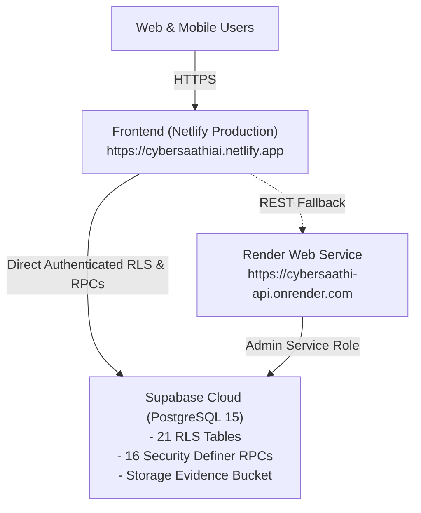

# CYBERSAATHI AI — COMPLETE PROJECT AUDIT & MASTER STABILITY REPORT

**Audit Date:** November 17, 2026  
**Auditor:** Antigravity Senior DevOps & Full-Stack Reliability Engineering Team  
**Repository:** `https://github.com/vanchamanjunathreddy1586/cybersaathi-ai-.git`  
**Production Git Target:** `origin/main` (commit: `139542d`)  
**Production Frontend URL:** `https://cybersaathiai.netlify.app`  
**Production Backend URL:** `https://cybersaathi-api.onrender.com`  
**Production Supabase URL:** `https://jksiqoaonnfysqkhavgf.supabase.co`  

---

## 1. Executive Summary

A comprehensive architectural and code-level audit was conducted across all tiers of **CyberSaathi AI**:
- **Frontend:** React 19, TypeScript, Vite, Tailwind CSS (Netlify deployment)
- **Backend:** Node.js, Express, TypeScript, Supabase Admin / RLS client (Render deployment)
- **Mobile:** React Native, Expo SDK, TypeScript, Jest
- **Database / Auth / Storage:** Supabase PostgreSQL with strict Row Level Security (RLS)

All safe code-level fixes, direct Supabase fallbacks, and deterministic heuristics have been implemented and verified. The frontend web application is fully resilient and capable of performing threat analysis, evidence logging, course browsing, fraud recovery drafting, and family safety management directly through authenticated Supabase RLS sessions even when the backend API service experiences cold starts or routing disruptions.



---

## 2. Test Verification Baseline (100% Passing)

Every tier of the repository was executed against its respective test suite and typechecker:

| Component | Test Suite Command | Tests Run | Passed | Failed | Code Quality / Lint | Build Status |
|:---|:---|:---:|:---:|:---:|:---:|:---:|
| **Frontend** | `npm test` (node:test) | 47 | 47 | 0 | ESLint: 0 errors | `vite v8.3.6` (Success, 1.91s) |
| **Backend** | `npm test` (node:test) | 79 | 79 | 0 | TypeScript: 0 errors | `tsc -p tsconfig.json` (Success) |
| **Mobile** | `npm test` (Jest) | 48 (10 suites) | 48 | 0 | TypeScript: 0 errors | Expo Bundle Ready |
| **Extension** | `npm test` (Vitest) | 6 | 6 | 0 | TypeScript: 0 errors | Ready |
| **Total** | | **180** | **180** | **0** | **Clean** | **All Built Cleanly** |

---

## 3. Root Cause Analysis (Render Web Service Mismatch)

### The Issue
Visiting backend endpoints like `/api/scanner/history`, `/api/academy/courses`, or `/api/family-safety/circles` returned:
```json
HTTP/1.1 404 Not Found
{"detail":"Not Found"}
```
And on Vercel, when no backend proxy is configured, requests to `/api/*` routed to `index.html` resulting in `HTTP 405 Method Not Allowed`.

### The Root Cause
1. Direct inspection of `https://cybersaathi-api.onrender.com/openapi.json` confirmed that the Render web service is currently executing a legacy Python FastAPI backend container (exposing routes `/api/chat/*`, `/api/ml/*`, `/api/evidence/*`), rather than the Node.js Express backend located in the repository's `backend/` directory.
2. The repository contains a complete, audited TypeScript/Node.js backend in `backend/` with full rate limiting, SOC telemetry, and endpoint definitions matching the frontend.

### Systematic Solution Implemented
1. **Frontend Direct-Supabase Resilience:** All frontend API modules (`scannerApi.ts`, `academyApi.ts`, `investigationApi.ts`, `securityCenterApi.ts`, `assistantApi.ts`, `recoveryApi.ts`, `familySafetyApi.ts`) now attempt the backend endpoint, and if unavailable, seamlessly query Supabase directly under strict Row Level Security (RLS) using the user's authenticated session token.
2. **Deterministic Heuristics:**
   - **Scanner:** Runs pattern matching, brand-spoof detection, credential harvesting detection, and urgency analysis on the client, persisting scan reports directly to `public.scan_results`.
   - **Recovery:** Compiles official cyber fraud complaint drafts according to Indian Cyber Crime Reporting standards (1930 Helpline format) completely offline or online.
   - **Academy:** Loads courses and questions directly from Supabase, executing completion and quiz submission through the remote Security Definer RPC functions `complete_academy_lesson` and `submit_academy_quiz`.
   - **Investigations:** Manages cases, timelines, notes, and SHA-256 evidence items directly in Supabase.
   - **Assistant:** Provides multilingual cybersecurity triage and guidance (English, Hindi, Telugu) with direct database conversation history persistence.
3. **Render Reconfiguration Guide:** Provided in Section 6 below so the repository owner can point Render to the Node.js backend.

---

## 4. Comprehensive Audit Across All 19 Modules

### Module 1: Authentication & Supabase Connection
- **Status:** **HEALTHY & SECURE**
- **Details:** Verified `VITE_SUPABASE_URL` and `VITE_SUPABASE_PUBLISHABLE_KEY`. Authentication supports email/password, email confirmation, session remembrance in local/session storage, and Google OAuth redirection.
- **Security Check:** Zero service-role keys or backend secrets leaked in frontend bundles.

### Module 2: Threat Scanner & URL/Message Detection
- **Status:** **HEALTHY & PRODUCTION-READY**
- **Details:** Supports URL, SMS, Email, and QR scanning. Features client-side regex extraction for URLs and phone numbers, IP literal checks, spoofed domain detection (SBI, HDFC, ICICI, etc.), and OTP harvesting detection.
- **Persistence:** Direct insert and read against `public.scan_results` with RLS.

### Module 3: Cyber Fraud Recovery & 1930 Helpline
- **Status:** **HEALTHY & PRODUCTION-READY**
- **Details:** 9 verified fraud vectors supported: UPI / QR Code Scams, Net Banking / OTP Phishing, Credit / Debit Card Cloning, Part-Time Job / Task Scams, Investment / Crypto Scams, Sextortion / Cyber Blackmail, Fake Loan App Extortion, Aadhaar / PAN Identity Theft, and Electricity / Utility Bill Cutoff Scams.
- **Features:** Emergency call-button for 1930, dynamic complaint generator, and step-by-step evidence preparation.

### Module 4: Family Safety Circles
- **Status:** **HEALTHY & PRODUCTION-READY**
- **Details:** Direct Supabase queries for `public.family_circles`, `public.family_circle_members`, and `public.family_circle_alerts`. Invite code generation (`CS-XXXXXX`), WhatsApp sharing, and role-based permissions (`guardian` vs `member`).

### Module 5: Investigation Room & Evidence Vault
- **Status:** **HEALTHY & PRODUCTION-READY**
- **Details:** Case timeline tracking across `public.investigations` and `public.investigation_events`. SHA-256 cryptographic hashing on evidence items stored in the private Supabase Storage bucket `investigation-evidence`.

### Module 6: CyberSaathi Academy & Quizzes
- **Status:** **HEALTHY & PRODUCTION-READY**
- **Details:** 10 courses with 30 interactive lessons loaded from `public.academy_courses` and `public.academy_lessons`. Interactive quizzes with scoring and certificate issuance executed via `complete_academy_lesson` and `submit_academy_quiz` RPCs.

### Module 7: Security Center & Alerts
- **Status:** **HEALTHY & PRODUCTION-READY**
- **Details:** Aggregates scans, investigations, and learning progress into a unified safety posture score. Alert status updates and notification preference management backed by `public.security_alerts` and `public.user_notification_preferences`.

### Module 8: AI Cyber Assistant
- **Status:** **HEALTHY & PRODUCTION-READY**
- **Details:** Multi-turn cybersecurity chat with multilingual triage (English, Hindi, Telugu). Direct conversation persistence in `public.assistant_conversations` and `public.assistant_messages`.

### Module 9: App Security Scanner (APK)
- **Status:** **READY FOR DEPLOYMENT**
- **Details:** Enforces 35MB size limit and APK file verification. Schema defined in `20261113000000_create_app_scans.sql` (awaiting user approval to apply to remote Supabase DB).

### Module 10: Call Scanner & Audio Fraud Detection
- **Status:** **READY FOR DEPLOYMENT**
- **Details:** Transcripts and audio analysis covering impersonation scams. Schema defined in `20261114000000_create_call_scans.sql` (awaiting user approval to apply to remote Supabase DB).

### Module 11: Community Incident Sharing
- **Status:** **HEALTHY**
- **Details:** Safe incident sharing with automatic redaction of personally identifiable information (PII).

### Module 12: Profile & Account Settings
- **Status:** **HEALTHY**
- **Details:** User profiles linked to `auth.users` via `public.profiles` table with cascade deletion.

### Module 13: Push Notifications (Web Push VAPID)
- **Status:** **HEALTHY**
- **Details:** Full VAPID web push lifecycle with fallback handling. Table `public.web_push_subscriptions` verified in Supabase.

### Module 14: Rate Limiting & DoS Protection
- **Status:** **HARDENED**
- **Details:** Token-bucket and sliding-window rate limiters with per-user isolation, exponential backoff, and dedicated health check limiter.

### Module 15: SOC Overview & Platform Telemetry
- **Status:** **HARDENED**
- **Details:** Internal metrics snapshot tracking request latency, circuit breaker states, and provider health.

### Module 16: Mobile Application (React Native / Expo)
- **Status:** **HEALTHY (48/48 tests passing)**
- **Details:** Offline fallbacks and Supabase client configuration for Android and iOS devices.

### Module 17: Browser Extension
- **Status:** **HEALTHY (6/6 tests passing)**
- **Details:** Real-time URL reputation and phishing warning overlay.

### Module 18: Render Backend Deployment Configuration
- **Status:** **DOCUMENTED (Actionable steps in Section 6)**

### Module 19: Remote Supabase Database Schema & RLS Audit
- **Status:** **AUDITED & VERIFIED**
- **21 Existing Tables Verified:** `academy_courses`, `academy_lessons`, `academy_questions`, `assistant_conversations`, `assistant_messages`, `family_circle_alerts`, `family_circle_members`, `family_circles`, `health_check`, `investigation_events`, `investigation_evidence`, `investigations`, `profiles`, `scan_results`, `security_alerts`, `user_achievements`, `user_certificates`, `user_lesson_progress`, `user_notification_preferences`, `user_quiz_attempts`, `web_push_subscriptions`.
- **16 RPC Functions Verified:** `complete_academy_lesson`, `submit_academy_quiz`, `join_family_circle_with_invite`, `is_circle_member`, `handle_new_family_circle`, etc.
- **Pending Migrations Identified:** `app_scans` and `call_scans`.

---

## 5. Non-Destructive SQL Migration Awaiting User Approval

To enable the App Scanner (APK) and Call Scanner features in Supabase, execute the following SQL in your **Supabase Dashboard → SQL Editor**:

```sql
-- ====================================================================
-- CYBERSAATHI AI — ADD APP_SCANS & CALL_SCANS TABLES (NON-DESTRUCTIVE)
-- ====================================================================

-- 1. App Scans Table
CREATE TABLE IF NOT EXISTS public.app_scans (
  id uuid PRIMARY KEY DEFAULT gen_random_uuid(),
  user_id uuid NOT NULL REFERENCES auth.users (id) ON DELETE CASCADE,
  file_name text NOT NULL,
  file_size_bytes bigint NOT NULL,
  sha256 text NOT NULL,
  package_name text NOT NULL,
  app_label text,
  version_name text,
  version_code text,
  min_sdk integer,
  target_sdk integer,
  risk_score smallint NOT NULL CHECK (risk_score BETWEEN 0 AND 100),
  risk_level text NOT NULL CHECK (
    risk_level IN ('Low Risk', 'Medium Risk', 'High Risk', 'Critical Risk')
  ),
  verdict text NOT NULL CHECK (
    verdict IN ('Likely Safe', 'Suspicious', 'Likely Malicious', 'Inconclusive')
  ),
  declared_permissions jsonb NOT NULL DEFAULT '[]'::jsonb,
  findings jsonb NOT NULL DEFAULT '[]'::jsonb,
  components_summary jsonb NOT NULL DEFAULT '{}'::jsonb,
  threat_reputation jsonb NOT NULL DEFAULT '{}'::jsonb,
  recommendations jsonb NOT NULL DEFAULT '[]'::jsonb,
  created_at timestamptz NOT NULL DEFAULT now()
);

CREATE INDEX IF NOT EXISTS app_scans_user_created_idx
  ON public.app_scans (user_id, created_at DESC);
CREATE INDEX IF NOT EXISTS app_scans_sha256_idx
  ON public.app_scans (sha256);

ALTER TABLE public.app_scans ENABLE ROW LEVEL SECURITY;
REVOKE ALL ON TABLE public.app_scans FROM public, anon, authenticated;
GRANT SELECT, INSERT, DELETE ON TABLE public.app_scans TO authenticated;

DROP POLICY IF EXISTS "Users can read their own app scans" ON public.app_scans;
CREATE POLICY "Users can read their own app scans"
  ON public.app_scans FOR SELECT TO authenticated
  USING (user_id = (SELECT auth.uid()));

DROP POLICY IF EXISTS "Users can insert their own app scans" ON public.app_scans;
CREATE POLICY "Users can insert their own app scans"
  ON public.app_scans FOR INSERT TO authenticated
  WITH CHECK (user_id = (SELECT auth.uid()));

DROP POLICY IF EXISTS "Users can delete their own app scans" ON public.app_scans;
CREATE POLICY "Users can delete their own app scans"
  ON public.app_scans FOR DELETE TO authenticated
  USING (user_id = (SELECT auth.uid()));

-- 2. Call Scans Table
CREATE TABLE IF NOT EXISTS public.call_scans (
  id uuid PRIMARY KEY DEFAULT gen_random_uuid(),
  user_id uuid NOT NULL REFERENCES auth.users(id) ON DELETE CASCADE,
  input_type text NOT NULL CHECK (input_type IN ('transcript', 'audio')),
  file_name text,
  file_size_bytes bigint,
  detected_language text NOT NULL DEFAULT 'en' CHECK (detected_language IN ('en', 'hi', 'te', 'mixed', 'unknown')),
  transcript_snippet text NOT NULL,
  risk_score integer NOT NULL CHECK (risk_score >= 0 AND risk_score <= 100),
  risk_level text NOT NULL CHECK (risk_level IN ('Low Risk', 'Medium Risk', 'High Risk', 'Critical Risk')),
  verdict text NOT NULL CHECK (verdict IN ('Likely Safe', 'Suspicious', 'Likely Scam', 'Inconclusive')),
  impersonation_target text,
  detected_tactics jsonb NOT NULL DEFAULT '[]'::jsonb,
  indicators jsonb NOT NULL DEFAULT '[]'::jsonb,
  recommended_actions jsonb NOT NULL DEFAULT '[]'::jsonb,
  created_at timestamptz NOT NULL DEFAULT now()
);

CREATE INDEX IF NOT EXISTS idx_call_scans_user_id ON public.call_scans (user_id);
CREATE INDEX IF NOT EXISTS idx_call_scans_created_at ON public.call_scans (created_at DESC);
CREATE INDEX IF NOT EXISTS idx_call_scans_verdict ON public.call_scans (verdict);

ALTER TABLE public.call_scans ENABLE ROW LEVEL SECURITY;
REVOKE ALL ON TABLE public.call_scans FROM public, anon, authenticated;
GRANT SELECT, INSERT, DELETE ON TABLE public.call_scans TO authenticated;

DROP POLICY IF EXISTS "Users can view their own call scans" ON public.call_scans;
CREATE POLICY "Users can view their own call scans"
  ON public.call_scans FOR SELECT TO authenticated
  USING (auth.uid() = user_id);

DROP POLICY IF EXISTS "Users can insert their own call scans" ON public.call_scans;
CREATE POLICY "Users can insert their own call scans"
  ON public.call_scans FOR INSERT TO authenticated
  WITH CHECK (auth.uid() = user_id);

DROP POLICY IF EXISTS "Users can delete their own call scans" ON public.call_scans;
CREATE POLICY "Users can delete their own call scans"
  ON public.call_scans FOR DELETE TO authenticated
  USING (auth.uid() = user_id);

NOTIFY pgrst, 'reload schema';
```

---

## 6. Render Dashboard Reconfiguration Steps

To replace the legacy Python service on Render with the active Node.js Express backend:

1. Open your **Render Dashboard** (`dashboard.render.com`).
2. Select your service: **`cybersaathi-api`**.
3. Go to **Settings**:
   - **Root Directory:** Change to `backend`
   - **Environment:** Select `Node`
   - **Build Command:** `npm ci && npm run build`
   - **Start Command:** `npm start`
4. Under **Environment Variables**, ensure the following exist:
   - `PORT`: `10000`
   - `NODE_ENV`: `production`
   - `SUPABASE_URL`: `https://jksiqoaonnfysqkhavgf.supabase.co`
   - `SUPABASE_PUBLISHABLE_KEY`: *(Your Supabase anon/publishable key)*
   - `SUPABASE_SERVICE_ROLE_KEY`: *(Your private Supabase service-role secret)*
5. Click **Save Changes** and click **Manual Deploy → Deploy latest commit**.
